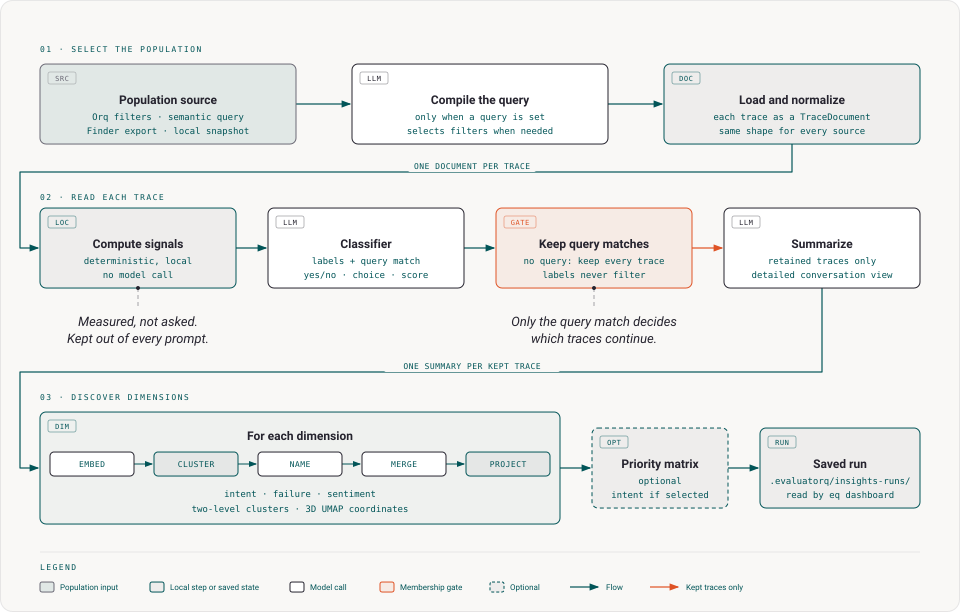

# Trace Insights

**Trace Insights** analyzes a chosen population of Orq traces or local snapshots, answers label questions, and groups traces by summary text. Use it to find patterns across conversations; use [Trace Finder](trace-finder.md) when you only need matching traces.

A run moves from population selection through labels and summaries to discovered dimensions, then saves a result for the dashboard. Signals are computed locally from each normalized trace before labeling and summarizing. A semantic query may make model calls while the population is selected.



The classifier and summary model read different inputs. The classifier reads its model-specific trace state plus the selected questions. The summary model reads the detailed conversation view. A query match controls which traces continue to summaries and dimensions; label answers do not change membership.

## What a run produces

| Result | Source | Meaning |
|---|---|---|
| Population | Filters, semantic query, Finder export, or local snapshot | Traces selected for analysis. A semantic query removes traces that do not match. |
| Labels | Fixed classifier questions | Yes/no (`noul`), choice, or score answers with confidence and probabilities. Labels do not filter traces. |
| Dimensions | Per-trace summaries | Two-level clusters, 3D UMAP coordinates, and a saved 2D review layout when enough traces can be projected. |
| Signals | Trace structure and recorded activity | Deterministic measurements computed before labeling and summarizing. They are kept out of model prompts. |

The built-in dimensions are `intent` (`request`), `failure` (`assistant_errors`), and `sentiment` (`sentiment_explanation`). Requesting the `sentiment` dimension adds the sentiment label if you did not select it. Summaries use the detailed [conversation view](#the-conversation-view), including tool calls and the start and end of tool results.

The view is shortened from the middle when needed to fit the input cap. The summary model does not use the classifier's compact Jev state.

Reports are written to `.evaluatorq/insights-runs/`, with manifests under `.evaluatorq/insights-runs/.manifests/`. Set `EVALUATORQ_DIR` to change the base directory. Run JSON does not contain message bodies or embedding vectors.

## Run from Python

Use `insights()` with an `InsightsPopulation`, optional labels, and dimensions. This example analyzes one agent over the last seven days, applies a semantic query, and adds a custom label. It reads live traces and makes model requests through Orq, so set `ORQ_API_KEY` first. Install the `insights` extra before importing this package path:

```bash
uv add "evaluatorq[insights]"
```

```python
import asyncio

from evaluatorq.insights import InsightsPopulation, LabelSpec, insights, presets


async def main() -> None:
    run = await insights(
        population=InsightsPopulation(
            query="customers asking about refunds",
            filters={"agent_name": ["support-bot"], "tokens_min": 100},
            window_days=7,
            limit=500,
        ),
        labels=[
            presets.SENTIMENT,
            presets.CUSTOMER_SATISFACTION,
            LabelSpec(
                name="needs_human_follow_up",
                kind="noul",
                instructions="Decide whether a human should follow up on this conversation.",
                criteria={
                    "true": "The customer needs a human to resolve the request.",
                    "false": "The assistant resolved the request without human help.",
                },
            ),
        ],
        dimensions=["intent", "failure", "sentiment"],
        summary_model="openai/gpt-6-sol",
        classifier_model="typesafe/jev-latest",
        embedding_model="openai/text-embedding-3-small",
    )
    print(run.status, run.counts)


asyncio.run(main())
```

`filters` is one dictionary for facet and numeric conditions. Older callers can still pass the legacy facet and numeric arguments, but do not mix those with `filters`. Unknown keys and conflicting inputs are rejected.

| Filter kind | Accepted keys | Values |
|---|---|---|
| Categorical | `project`, `project_id`, `model`, `provider`, `status`, `product`, `trace_type`, `agent_name`, `tool_name` | Lists or sets of values. `project_id` takes one string. |
| Numeric | `tokens_min`, `tokens_max`, `duration_ms_min`, `duration_ms_max` | Inclusive lower and upper bounds. |

Finder exports and local snapshots set the population themselves, so they cannot be combined with filters, a query, a time window, or a limit. Use `InsightsPopulation.from_finder_export(path)` for an `eq find --json` export, or `InsightsPopulation.from_snapshot(path)` for a local JSON file validated as `trace_finder.models.Snapshot`.

Finder exports pin matched trace IDs and include the query window used to reload messages from Orq. Older exports without a recorded window must be exported again. A local snapshot contains messages and needs no Orq trace fetch.

Explicit `start` and `end` bounds need timezone offsets, and `start` cannot be later than `end`; invalid bounds fail before traces load. Model requests still require an Orq credential.

## Run from the CLI

The `eq insights` command accepts population filters, label presets or JSON files, and discovered dimensions. Install `evaluatorq[insights]` before running it.

| Choice | Behavior |
|---|---|
| Credentials | An explicit `--profile NAME` wins over the profile selected in dashboard Settings, which wins over `ORQ_API_KEY`. The selected profile supplies the API key and host for traces and model calls. If it is unavailable, the command exits with an error instead of trying another key. |
| `--query` | The classifier answers the query match and selected label questions in the same per-trace request. Non-matches and failed match judgments are excluded from summaries and dimensions; failed judgments are counted and explained in a warning. |
| Filters only or `--from-finder` | Selects traces without asking a new match question. |

```bash
eq insights --query "customers asking about refunds" --agent support-bot --label sentiment --label customer_satisfaction --dimension intent --dimension failure --limit 500 --json refunds-insights.json
```

For query-based population selection, `--filter-selection llm|llm+jev` overrides the saved dashboard mode (default `llm+jev`) and requires `--query`. `llm` uses the configured fast `finder.filters` task for facets, numeric bounds and time bounds; `llm+jev` uses the configured `finder.classifier` for facets while the shared compiler supplies numeric and time bounds in both modes. The compiler runs before facet selection. Each catalogue request supplies up to 50 values per facet for its actual time window. Candidate extraction is limited to eight values from `model`, `provider`, `agent`, `tool`, or `project` mentions, slash-qualified model names, and quoted strings up to 100 characters; a candidate outside the catalogue is used only after exact trace confirmation. Generated calendar dates may narrow or replace the configured default window; explicitly supplied windows keep their bounds. The mode and generated-window behavior are the same whether or not you pass `--filter-selection`.

The five-minute facet-catalogue cache is scoped to the Orq host, credentials, workspace/project scope and limit. Exact time bounds distinguish explicit-window entries; default-window entries are grouped by window duration.

The command prints cluster and label summaries, failed-trace counts, projection coverage, and the saved run path. `--from-finder` and `--from-snapshot` cannot be combined with `--filter-selection`; file sources fix the population. Other options and preview behavior are listed below.

| Option | Purpose and constraints |
|---|---|
| `--from-finder PATH` | Analyze the matched trace IDs in a Finder export instead of running `--query`. |
| `--from-snapshot PATH` | Analyze local traces with embedded messages. |
| File-source limits | Finder exports and snapshots reject other population filters, `--window-days`, and `--limit`. |
| `--preview-input` | With `--from-snapshot PATH`, measure truncation without model requests or an Orq credential. Full runs still need an Orq credential for model requests. |
| `--no-cache` | Bypass the local summary and embedding cache. |

The priority matrix uses `intent` when selected, otherwise the first `--dimension`. `--priority-dimension` must name one of the selected dimensions.

`--max-clusters`, `--max-subclusters` and `--outlier-zscore` bound the cluster tree each dimension produces; see [Shape the discovered-dimension clusters](#shape-the-discovered-dimension-clusters).

| Model option | Default role and model |
|---|---|
| `--summary-model` | `smart`, currently `openai/gpt-6-sol` |
| `--classifier-model` | `classifier`, currently `typesafe/jev-latest` |
| `--embedding-model` | `embedding`, currently `openai/text-embedding-3-small` |

Set these roles with `EVALUATORQ_SMART_MODEL`, `EVALUATORQ_CLASSIFIER_MODEL`, and `EVALUATORQ_EMBEDDING_MODEL`, dashboard Settings, or the global `--smart-model`, `--classifier-model`, and `--embedding-model` flags. See [Configuration › Models](configuration.md#models). An explicit model option overrides its role.

After a finder run completes, its **Analyze matches** section lets you download the finder export. Pass the downloaded filename to `--from-finder`; Insights selects only the matched trace IDs from that export. For a file named `trace-finder-42.json`, this command reviews those matches:

```bash
eq insights --from-finder trace-finder-42.json --label sentiment --dimension intent --json insights.json
```

## Add a fixed label

Save one label object or a list of label objects as JSON, then pass its path with repeatable `--label`. A choice label must provide its answer names and descriptions in `criteria`.

```json
{
  "name": "resolution_status",
  "kind": "choice",
  "instructions": "Classify how the assistant handled the customer's request.",
  "criteria": {
    "resolved": "The assistant completed the requested task.",
    "partially_resolved": "The assistant made progress but left part of the request open.",
    "unresolved": "The assistant did not resolve the request."
  }
}
```

```bash
eq insights --query "customers asking about refunds" --label ./resolution-label.json --dimension intent
```

## Shape the discovered-dimension clusters

Every discovered dimension groups its traces into a two-level tree: **base clusters** of closely similar traces, gathered into **top clusters**. The dashboard calls a top cluster a **theme** and a base cluster a **subtheme**, so `--max-clusters` caps themes and `--max-subclusters` caps the subthemes inside one theme. Asking for at most six themes means capping `--max-clusters`, and the finer groups you can see under them are the subthemes. Three settings bound that tree. Set them on the CLI or in Python — the dashboard's run form does not offer them.

Reach for them when a saved run is unreadable in one of two directions: one top cluster holding most of the population, or dozens of near-duplicate base clusters nobody can act on. Not before.

| Setting | CLI | Python | Default | What it bounds |
|---|---|---|---|---|
| Top clusters | `--max-clusters N` | `max_clusters=N` | `15` | The most top clusters one cluster tree may produce. |
| Base clusters per top cluster | `--max-subclusters N` | `max_subclusters=N` | `15` | The most base clusters any single top cluster may hold, at `2` and above. `1` is unreliable — see below. |
| Outlier removal | `--outlier-zscore Z` | `outlier_zscore=Z` | off | How far a trace may sit from its base cluster's centre before it is moved to noise. |

`sentiment` is the one dimension that builds more than one tree: it clusters each sentiment answer on its own, so both caps apply per answer and the dimension can show several times `--max-clusters` top clusters.

Neither cap is a target. The run picks its own cut of the hierarchy, so lowering `--max-clusters` from `15` to `3` changes nothing on a population whose natural cut is already two groups.

**Neither cap is a pure ceiling either.** When no cut of a population stands out — common for traces of one agent doing one job — `max_clusters * max_subclusters` drives the base-cluster count instead, so on flat data *raising* either cap produces **more** base clusters, not fewer. That effect saturates at one base cluster per ten traces, past which raising a cap again does nothing. Lowering both caps is what cures the second symptom above.

**Tightening `--max-subclusters` is the lever for the first symptom**: a top level collapsed into one group splits by lowering `--max-subclusters`, not by raising `--max-clusters`. If the top level cannot grow any further, the run merges the smallest base cluster in the offending group into its nearest sibling — the one case where a cap destroys structure — and logs a `WARNING` naming the group and the cap. That warning reaches the terminal only; it is not recorded in the saved run.

**Do not rely on `--max-subclusters 1`.** The cap is applied and then partly undone: a top cluster holding ten or more traces whose split leaves halves of at least five each is split back into two, while smaller groups keep their single cluster. So some groups honour the cap and some do not, and only the narrowest configuration warns. This is a defect in the clustering code rather than a deliberate floor, reported in the pull request that added this section; `2` is the tightest value that holds everywhere.

`--outlier-zscore` moves a trace to noise when its distance from its base cluster's centre exceeds that cluster's mean distance plus `Z` standard deviations, so **a lower `Z` removes more traces**. Only base clusters with at least three members are examined. Start at `2.0` and lower it only if too little moves: the rule measures distance from a centre, not strangeness, so an ordinary trace sitting at the edge of a broad cluster is moved on exactly the same basis as a genuine one-off. Read back which traces went before you trust the cleaned groups. A pass that moves at least one trace logs a `WARNING` with the number it flagged.

A moved trace is not deleted. It stays in the run with its dimension assignment set to `noise` and counts into `DimensionResult.n_noise`. In the dashboard's review page they land in a pseudo-theme called **Not grouped**, pooled with traces that had no text to group, so that row can exceed `n_noise`; its description splits the two counts. Do not go looking for the word outlier there. A dimension's own tab renders the count separately as an **Outliers (noise)** row.

Reading the result back takes the saved run either way. The CLI prints at most five top clusters per dimension, under a heading that says `(top 5)`, so a dimension capped above five cannot be read off the terminal, and its printed summary counts traces and failed traces without mentioning noise. In the run JSON every trace carries `assignments.<dimension>.top` and `.base`, both set to `noise` for a trace that was moved.

The example below reaches into `evaluatorq.insights.cluster`, which is internal and carries no stability promise. It makes no model requests and needs no credential, so the `insights` extra is all it takes to run.

```python
import numpy as np
from evaluatorq.insights.cluster import cluster_two_level

rng = np.random.default_rng(0)
centres = rng.normal(0, 1, size=(12, 8))
vectors = np.vstack([rng.normal(centre, 0.05, size=(10, 8)) for centre in centres])

for max_clusters, max_subclusters in ((15, 15), (3, 15), (15, 2)):
    tree = cluster_two_level(vectors, max_clusters=max_clusters, max_subclusters=max_subclusters)
    print(f"max_clusters={max_clusters:<3} max_subclusters={max_subclusters:<3} -> {tree.n_top} top, {tree.n_base} base")

for zscore in (None, 3.0, 2.0, 1.0, 0.5):
    tree = cluster_two_level(vectors, outlier_zscore=zscore)
    moved = int((tree.base_labels == -1).sum())
    print(f"outlier_zscore={str(zscore):<4} -> {moved} of 120 traces moved to noise")

flat = rng.normal(0, 1, size=(200, 8))  # no structure to find: the caps drive the cut
for max_clusters, max_subclusters in ((2, 2), (4, 4), (15, 15)):
    tree = cluster_two_level(flat, max_clusters=max_clusters, max_subclusters=max_subclusters)
    print(f"flat: max_clusters={max_clusters:<3} max_subclusters={max_subclusters:<3} -> {tree.n_top} top, {tree.n_base} base")
```

These counts are the raw tree. A real run then asks the classifier to fold near-duplicate base clusters together, so a saved run's counts are no higher than these and usually lower.

**Below ten traces in a dimension, both caps do nothing, and nothing says so.** The run needs twice its minimum cluster size of five before it will split at all, so a dimension under that floor returns one base cluster inside one top cluster whatever you pass. `--outlier-zscore` is the exception: it still runs on that single cluster, still moves traces to noise, and still logs what it moved. Check `run.counts` before concluding that a cap misbehaved.

Below five traces carrying signal the dimension is skipped outright, produces no clusters, and the run records `dimension <name> skipped: only N traces have signal (need at least 5)` in its warnings, with `trace has` in place of `traces have` when N is one.

At the other end, a clustered population of more than 5000 traces fails rather than sampling traces away, with `clustering supports at most 5000 traces per population`. That dimension is dropped and the run still saves, with `status='error'` and every other dimension intact. The 5000 counts per clustered population — per sentiment answer for `sentiment` — and only traces carrying signal count toward it. Since `--limit` itself stops at 5000, only a Finder export or a snapshot can cross the line, so the fix is to export or snapshot fewer traces.

Bad values are rejected before any model is called: the CLI rejects an out-of-range number while parsing the command, and `insights()` raises before it fetches a trace.

## Analyze coding agents

Pass `--coding` (or `coding_analysis=True` in Python, or tick individual **Coding agent questions** in the dashboard run form) to add coding-agent labels to a run. Insights first asks the classifier whether each trace comes from a coding agent, using only a count of the tools, shell programs, and skills the trace called. Traces it answers yes for get two more sets of questions; other traces get only the labels you selected.

| Label | Kind | Read from | Answers |
|---|---|---|---|
| `coding_agent` | yes/no | Tool counts | Whether the trace is a coding agent's session. |
| `task_type` | choice | Conversation | `bugfix`, `feature`, `refactor`, `docs`, `maintenance`, `investigation`, `review_followup`, `infra_ops`, `planning`, or `question`. |
| `outcome` | choice | Conversation | `done`, `partial`, `not_done`, `cut_off`, or `inconclusive`. |
| `verified` | choice | Conversation | `verified`, `claimed_without_check`, `unverified`, or `not_applicable`. |
| `scope_creep` | yes/no | Conversation | Whether the agent changed things the user did not ask for. |
| `user_corrections` | score | Conversation | How often the user had to correct the agent, from none to repeatedly. |
| `unfixed_error` | yes/no | Tool calls | Whether a tool error was left unresolved at the end. |
| `risky_action` | choice | Tool calls | The most serious destructive or hard-to-undo action the agent took without being asked: `none`, `deleted`, `history_rewrite`, `merged_or_closed`, `published`, `infra_change`, or `secret_exposed`. A plain push is routine. |

The conversation labels are asked in the same classifier call as your selected labels. The tool-call labels get their own call.

Non-Jev tool views read the first 300 characters of each input; non-shell result bodies are omitted except for a diagnostic category, while shell results also keep fixed failure markers and their first and last 150 characters.

Jev tool views keep the first and last 100 characters of each input and result, plus recorded status, exit code, and error code; shell failure markers are checked across the full scrubbed output. Jev inputs and results are scrubbed before excerpting, and non-Jev shell outputs are scrubbed before their excerpts.

If a non-Jev tool view is too long, Insights cuts the middle only when at most 30% is lost; otherwise it splits calls into ordered parts. Jev splits complete tool records into chunks that reserve the exact serialized selected questions under the global input cap and fit the Jev state-plus-question ceilings.

`risky_action` takes the most confident answer other than `none` from any part, and `unfixed_error` takes the answer from the last part, because an error only counts as unfixed if it is still broken at the end. If a part fails and no other part found anything, the label fails rather than reading as no.

You cannot name your own label after one of these. A coding label a trace was not asked counts as not asked, not as failed.

Jev coding-tool requests use filtered structured states containing user messages, calls, paired results, and orphan results. Each chunk reserves the exact serialized coding question payload from the configured total input cap, then keeps complete call/result records together under the resulting Jev state ceiling. Final request fitting cannot drop calls from the middle of a chunk.

```bash
eq insights --from-snapshot claude-traces.json --label sentiment --label user_frustration --coding
```

## Local coding-agent sessions

A **local session** is one conversation that Claude Code, Claude desktop, Codex or omp saved as a file on your computer. Insights can search those files and analyze the sessions you pick the same way it analyzes traces from Orq. It does not read sessions on another machine, and it does not analyze delegated work; see [Subagents are not analyzed](#subagents-are-not-analyzed).

### Analyze sessions from the CLI

Use `eq insights --sessions` to select and analyze local sessions in one command. This example uses `--project-dir .` and `--from` to analyze up to 1000 of the newest sessions run in the current repository since 1 October:

```bash
eq insights --sessions --project-dir . --from 2026-10-01 --coding
```

The command searches locally, freezes the matching sessions into a private temporary snapshot, and uses the normal Insights pipeline. The temporary file is removed when the command ends. `--coding` adds the coding-agent questions described in [Analyze coding agents](#analyze-coding-agents): task type, outcome, whether the agent verified its work, unfixed tool errors and risky actions.

Use `eq agent-sessions` to inspect the matches without model calls, or export a reusable snapshot:

```bash
eq agent-sessions --project-dir . --from 2026-10-01 --export sessions.json
eq insights --from-snapshot sessions.json --coding
```

Listing and exporting read local files only. On POSIX systems, an export is written with owner-only file permissions; on Windows, access depends on the destination folder's permissions. You can still copy or share the snapshot.

`--export` writes the sessions that were listed. Without `--limit`, an export lists up to 1000 sessions, while a plain listing shows 50; an explicit `--limit` always wins. When the list is full, stderr says `Listed the newest 1000 sessions; narrow --from/--to or --text to see more.` Narrow the dates or text so the export holds the sessions you mean to analyze. If the 20-second search deadline cut the search short, stderr also says the export is partial.

The session list shows when and where each session ran, not how it went. Finding the sessions that went badly takes a model run: `eq insights --sessions --coding` labels each session's outcome, verification, unfixed errors and risky actions.

The deterministic [trace signals](#trace-signals) saved with the run count tool errors and retries without a model, but they describe structure, not whether the work succeeded. `eq agent-sessions --json` prints the matches as a JSON array on stdout instead of the table.

To get from a finished run to the sessions that went badly, open the run in `eq dashboard` under **Insights** and select the `outcome` value `not_done` or `partial`, or the `unfixed_error` value yes, in **Themes**; the trace list then holds only those sessions (see [Review a run](#review-a-run)).

Each trace ID is `<source>:<session ID>`, built from the `source` and `session_id` fields that `eq agent-sessions --json` prints next to each session's `path`.

A selection holds at most 1000 sessions. Sessions that fail to load are reported on stderr and skipped; the export fails only when none loads. When two selected files share a session ID, the export keeps the one that ends later. Before the run starts, the CLI states where the sessions go:

```console
Sending 3 traces (290.5 KB) from sessions.json to models: summary openai/gpt-6-sol, classifier typesafe/jev-latest, embedding openai/text-embedding-3-small.
```

The size is the snapshot file on disk, not the amount sent. Summaries receive the [conversation view](#the-conversation-view), cut further as needed so the whole summary prompt fits `trace_input_chars` (500,000 characters by default).

Classification uses the model-specific state and question budget described in [What the classifier reads](#what-the-classifier-reads); Jev uses structured excerpts rather than the full summary transcript. The embedding model reads the summaries.

Known credential patterns are scrubbed locally before rendering, but this does not remove all personal or confidential content. There is no confirmation prompt. Check the models named in that line before you run.

To check what a run would send without sending anything, run the preview. It needs no Orq credential, and it ends with the same sentence worded as what a run would send. Its coverage line uses the run's summary and classifier renderers, configured input cap, classifier model and selected questions:

```bash
eq insights --from-snapshot sessions.json --preview-input
```

```console
Model input coverage: 0 of 2 traces hit a summary or classifier input cap of 500,000 characters. Average rendered inputs: summary 3,053 characters; classifier request 768 (state 412, questions 356). 0 of 8 source messages were omitted from the Jev classifier state.
A run would send 2 traces (3.9 KB) from sessions.json to models: summary openai/gpt-6-sol, classifier typesafe/jev-latest, embedding openai/text-embedding-3-small.
```

The coverage line reports how many traces hit a summary or classifier cap, average rendered character counts for the summary and combined classifier request, and messages omitted from Jev state. These are character counts, not exact tokenizer counts. You can preview a fresh selection without exporting it first:

```bash
eq insights --sessions --project-dir . --from 2026-10-01 --preview-input
```

### Analyze sessions from the dashboard

In **Insights → New run**, choose **Local sessions**, the third tab next to **Orq traces** and **Trace file**. Use the source checkboxes to select any combination of Claude Code, Claude desktop, Codex and omp. Open the **Last 7 days** menu to choose **Last 30 days** or **All dates**, or expand **Custom range** inside that menu.

Set From and To with the native calendar controls, then press **Apply range**. These dates use your browser's local timezone, include the whole To day, and can be left open-ended. Click outside the date menu to close it without changing the date bounds. **Project directory** includes projects below that directory and linked Git worktrees.

Enter `~` for projects under the home directory of the dashboard user, or leave it blank for every recorded project location. **Browse** opens a folder browser on the machine running the dashboard, with breadcrumbs, Home, Parent and more folders when needed. Navigate, then press **Use this folder**; **Cancel** keeps the path you typed.

Browsing lists folder names without uploading or reading file contents. The filter matches project locations recorded in sessions; it does not scan project files or look for session stores in that directory.

**Contains text** is a case-insensitive literal substring, not a regular expression. For example, `error` matches `ERROR`, but `error|timeout` searches for those exact characters rather than either word.

Press **Search**, tick the sessions you want, or the header box for all of them, up to 1000, and press **Continue**. That freezes the selection into a snapshot in the dashboard's Insights folder. The **Review** step shows the same `Sending N traces` sentence as the CLI. A snapshot over the 100 MiB upload limit is rejected with a message to select fewer sessions.

When the 20-second deadline passes, the results say `Searched N of M session files before the 20-second limit. Narrow the dates or text to see the rest.`

### Search sessions

`eq agent-sessions` lists sessions newest first. Every filter is optional and they combine. The same filters work with `eq insights --sessions`; that command defaults to 1000 sessions and accepts `--preview-input` to stop before model requests. Session filters require `--sessions`, and local-session selection cannot be combined with `--query`, either file-source option, or Orq population filters.

| Source | Default folders | Override |
|---|---|---|
| `claude-code` | `~/.claude/projects` | `CLAUDE_CONFIG_DIR` (replaces `~/.claude`) |
| `claude-desktop` | Claude desktop's code sessions in `~/.claude/projects`, and Cowork sessions in the folder named below | `CLAUDE_CONFIG_DIR` for the first; none for the Cowork folder |
| `codex` | `~/.codex/sessions` and `~/.codex/archived_sessions` | `CODEX_HOME` (replaces `~/.codex`) |
| `omp` | `~/.omp/agent/sessions` | `PI_CODING_AGENT_DIR` (replaces `~/.omp/agent`) |

Cowork is Claude desktop's agent mode, which runs sessions in a virtual machine. Insights reads its sessions from `~/Library/Application Support/Claude/local-agent-mode-sessions` on macOS, `%APPDATA%/Claude/local-agent-mode-sessions` on Windows and `~/.config/Claude/local-agent-mode-sessions` on Linux. Only the macOS path has been checked against a real install. A missing folder is skipped silently.

| Flag | Matches |
|---|---|
| `--source` | `claude-code`, `claude-desktop`, `codex` or `omp`; repeat the flag for several. Default: all four |
| `--from`, `--to` | Sessions whose time span overlaps the window. Both are `YYYY-MM-DD` in local time, and `--to` includes that whole day |
| `--project-dir` | Sessions run in that directory, below it, or in a linked git worktree of it, so `--project-dir .` also finds sessions from sibling worktrees of the same repository. A deleted worktree and a Cowork VM path match only when written the same way as the session's own path |
| `--text` | Case-insensitive literal substring in any message, including system notices and Claude's thinking, up to 500 characters; not a regular expression. Tool calls and tool output are not searched |
| `--limit` | Maximum sessions, 1 to 1000. `eq agent-sessions` defaults to 50, or 1000 with `--export`; `eq insights --sessions` defaults to 1000 |
| `--json` | On `eq agent-sessions`, print the matches as a JSON array on stdout instead of the table |
| `--export` | On `eq agent-sessions`, write the listed sessions as a snapshot file |

The search stops at 20 seconds, and the deadline also covers listing the session files, so a very large session folder cannot run past it. The sessions found so far are listed, and stderr says `Searched N of M session files before the 20s limit; narrow --from/--to or --text to see the rest.` M counts the files found before the stop. A short list after that note may be incomplete.

Claude Code, Claude desktop, Codex and omp sessions are listed even when no user prompt appears in the first 256 KB of the file. Such a session has a blank title in the CLI and `(untitled)` in the dashboard, unless Codex stored a thread name.

### Subagents are not analyzed

Subagent transcripts are excluded from search and cannot be selected: Codex subagent rollouts, Claude `subagents/` files and sidechains (Claude's name for a delegated conversation kept apart from the main thread), and omp sessions nested under another session or carrying a `parentSession`. A Codex subagent's report back to the main agent still appears in the main session, as a system message.

### What a session loses on the way in

A session becomes one ATIF trajectory, the step-by-step format Insights stores each trace in, inside a [local trace file](#local-trace-file-format). Some content does not survive:

- Claude hook attachments and Codex encrypted reasoning are dropped.
- Images become the text `[image]`.
- Tool output, and each tool argument value, over 20,000 characters is cut with a `[truncated N chars]` marker. This read-time cap bounds memory and snapshot size by keeping the first and last 10,000 characters and removing the middle. Models cannot analyze the removed text; a failure marker found only in that middle is lost.
- omp extension state (`custom` records) and hidden notices are dropped. omp skill prompts and displayed background-job results are kept.
The model-input cap applies separately to the retained session content: a long summary transcript or classifier state can lose more text to fit its request budget. See [What the classifier reads](#what-the-classifier-reads) for the model-specific caps.

## What the classifier reads

The classifier does not read the summary. `trace_input_chars`, saved in Dashboard Settings and defaulting to 500,000, caps classifier state and the exact serialized question payloads together.

For `typesafe/jev` models, the state is indexed and structured; tool calls are grouped with matching results, recorded status and error codes are retained, and text excerpts keep the first and last 100 characters for tool inputs/results, 500 for assistant messages, 1,000 for user messages, and 4,000 for system/developer messages.

Jev state is also capped at 112,000 characters; state plus the longest question stays within 128,000 characters and state plus all questions within 256,000 characters. Credentials are scrubbed before excerpting; reasoning and known `<system-reminder>` sections are removed. Inline images show their size when known, and remote media is never fetched.

Other classifiers receive the `DETAILED` [conversation view](#the-conversation-view), shortened as needed to leave room for their selected questions. Known media parts render as placeholders, while unrelated structured content remains JSON. The source trace stays unchanged.

Every trace also records how often it called each tool, shell program, and skill, counted from its messages. The trace detail page lists them under **Tool use**.

### The conversation view

The **conversation view** is the plain-text transcript that summaries, non-Jev classifiers and Trace Finder read. Read this when you call `full_conversation_view` from Python, or when you need to know what a summary or label was based on. It does not apply to `typesafe/jev` models, which read the structured state above, or to the coding-agent tool labels, which read a separate one-line-per-call tool activity list.

Each entry starts with `#<message index> <kind>:` at the left edge. A line break inside a message is indented two spaces, so text a user pasted cannot pose as a new turn. A tool call and its result both name the call as `<tool> (call <message>.<n>)`, and both carry `[error]` or `[pending]` when the call did not complete. Credentials are scrubbed and each `<system-reminder>` block becomes `[harness reminder omitted]` before anything is cut.

```python
from datetime import datetime, timezone

from evaluatorq.insights.transcript import DETAILED, full_conversation_view
from evaluatorq.trace_finder.models import TraceRecord

bash = {'name': 'Bash', 'arguments': '{"command": "uv run pytest -q"}'}
# Only `messages` changes the rendering; the other fields are required metadata.

trace = TraceRecord(
    schema_version=1,
    trace_id='demo',
    span_id='demo',
    timestamp=datetime(2026, 10, 1, tzinfo=timezone.utc),
    project='default',
    model='claude',
    provider='anthropic',
    status='completed',
    product='agent',
    trace_type='conversation',
    messages=(
        {'role': 'user', 'content': 'Fix the failing parser test.'},
        {
            'role': 'assistant',
            'content': 'Running the tests first.',
            'reasoning_content': 'I need the failure output.',
            'tool_calls': [{'id': 'c1', 'function': bash}],
        },
        {'role': 'tool', 'tool_call_id': 'c1', 'content': 'FAILED test_dates\n1 failed, 3 passed', 'is_error': True},
        {'role': 'assistant', 'content': 'The date parser drops the timezone; fixing it.'},
    ),
)

print(full_conversation_view(trace, budget=50_000, options=DETAILED))
print()
print(full_conversation_view(trace, budget=50_000))
print()
print(full_conversation_view(trace, budget=50_000, options=DETAILED, include=DETAILED.include | {'reasoning'}))
```

```console
#0 user: Fix the failing parser test.

#1 assistant: Running the tests first.

#1 tool input Bash (call 1.1) [error]: uv run pytest -q

#2 tool result Bash (call 1.1) [error]: FAILED test_dates

  1 failed, 3 passed
#3 assistant: The date parser drops the timezone; fixing it.

#0 user: Fix the failing parser test.

#1 assistant: Running the tests first.

#1 tools: Bash: pytest [error]

#3 assistant: The date parser drops the timezone; fixing it.

#0 user: Fix the failing parser test.

#1 reasoning: I need the failure output.

#1 assistant: Running the tests first.

#1 tool input Bash (call 1.1) [error]: uv run pytest -q

#2 tool result Bash (call 1.1) [error]: FAILED test_dates

  1 failed, 3 passed
#3 assistant: The date parser drops the timezone; fixing it.

```

The three calls print `DETAILED`, which summaries and classifiers pass, then the default `COMPACT`, then `DETAILED` with reasoning added. Reasoning is read from a message's `reasoning_content`, `reasoning` or `thinking` field, or from reasoning content parts.

The `options` argument takes one of three presets from `evaluatorq.insights.transcript`, and defaults to `COMPACT`. None of them include reasoning. `full_conversation_view` accepts a `TraceRecord`, as here, or a loaded `TraceDocument`.

| Preset | Use it when | Tool calls | Characters kept per message |
|---|---|---|---|
| `COMPACT`, the default | You want the cheapest overview | One `tools:` line per message, no results | System whole, user 8,000, assistant 1,000 |
| `DETAILED` | You need every call's input and the start and end of its result; summaries and classifiers use it | One line per call and one per result | As `COMPACT`, plus 300 for each tool input and each tool result |
| `WHOLE` | No single message may be cut; Trace Finder uses it | One line per call and one per result | Every rendered message whole |

A cap keeps that many characters, split between the start and end of the text, and leaves `[... N chars left out ...]` in between; text within 40 characters of its cap is kept whole. In the `tools:` line, `COMPACT` shortens a shell command to its program name and keeps a risky one, such as `rm -rf`, up to 300 characters.

A keyword argument replaces one field of the preset: `tools`, `include`, `exclude`, and the caps `system_chars`, `user_chars`, `assistant_chars`, `reasoning_chars` (2,000 by default), `tool_input_chars` and `tool_result_chars`, where `-1` keeps the type whole.

The message types are `system`, `user`, `assistant`, `reasoning`, `tool_input` and `tool_result`; a developer message counts as `system`. `include` replaces the preset's set rather than adding to it, so add reasoning with `include=DETAILED.include | {'reasoning'}`, or every tool line disappears.

A cap on a type the preset leaves out does nothing, silently: `full_conversation_view(trace, tool_result_chars=-1)` still shows no results, because `COMPACT` renders none. Start from `DETAILED` or `WHOLE` to see results, as in `full_conversation_view(trace, options=DETAILED, tool_result_chars=-1)`.

Combining `tools='collapsed'` with `tool_result` in `include` raises a `ValueError` rather than dropping the results, and so does naming one type in both `include` and `exclude`.

The whole view is then cut to `budget`, which defaults to the `trace_input_chars` setting, so even `WHOLE` can omit entries on a very long trace. The cut drops whole rendered entries from the middle and leaves a marker such as `[... 4 messages (1-4) left out ...]`. If an entry at either boundary is too large for the remaining budget, the renderer keeps its beginning and end and marks the omitted text, for example `[... 5,000 chars of message 7 left out ...]`.

`ReadableStyle` opt-in formatting and reductions compose with any preset; the default style leaves the production view unchanged. `blocks=True` gives each entry its own header and indents its body, while `pair_results=True` moves each matched tool result beside its call when block layout is enabled. `plain_tool_input=True` formats object arguments as `key: value` lines, and `labelled_cuts=True` puts the kind and exact omission count in a bounded cut marker. Reductions can strip ANSI/progress redraw noise, shorten an explicitly recorded working directory, collapse consecutive repeated calls/results, or replace long encoded blobs with size markers. Secrets are scrubbed before reductions and cuts.

## Trace signals

A **trace signal** measures recorded structure, tool use, or autonomy. Insights computes signals from every selected trace before labeling and summarizing; failures in those later stages do not discard them, and signals are not added to model prompts.

Each trace is normalized as a `TraceDocument` with an ATIF trajectory and typed metadata. Signals live in `metadata.signals`; existing message snapshots are converted at the source boundary, but conversion cannot recover fields the source never recorded. Benchmark datasets can also carry typed provenance and ground truth outside the trajectory; see [Wrap a dataset trajectory](formats.md#wrap-a-dataset-trajectory).

Message-only snapshots support message and tool-call counts, argument repetition, and result sizes. Other measurements need the recorded inputs below; missing inputs produce **No basis** by default.

| Measurements | Required recorded input |
|---|---|
| `total_input_tokens`, `total_output_tokens`, `total_tokens`, `cache_read_token_share`, `peak_context_tokens` | Per-model-call token usage, including cached tokens where required. |
| `finish_reason_length_count` | Model finish reasons. |
| `tool_error_count`, `tool_error_rate` | Explicit tool-result success or error status. Optional content checks estimate this from result text. |
| `tool_retry_count`, `tool_succeeded_after_retry_count` | Tool-result status when a matching prior call exists. Content checks are optional when results are present. |
| `invalid_schema_tool_call_count` | Tool definitions active when each call occurred. |
| `wall_time_ms`, `active_time_ms`, `llm_time_ms`, `tool_time_ms` | Model and tool timestamps; model-step timestamps alone can yield approximations. |
| `max_autonomous_duration_ms` | A timestamp on each segment's root user step and subsequent root agent activity. |

A tag is **No basis** when missing inputs prevent a decision. A known false mandatory condition, or too few remaining conditions to satisfy the rule, makes it **Clear**. With complete tool-call coverage, retry count is zero when no call matches the configured retry definition; otherwise missing status remains unknown. Known shell, web, skill, and subagent tools have built-in roles in `SignalsConfig.tool_roles`; map custom names yourself. Delegation measurements cover only subagent structure captured in ATIF. See the [signal reference](signals.md#signal-reference) for measurement inputs.

In the run's **Analysis** view, fired L4 tags appear as chips; when none fired, the view says so. **All signals** starts collapsed and contains four groups: **L4 Tags**, **L3 Autonomy**, **L2 Tools**, and **L1 Structure**. Expand a signal to see its value, outcome, and preconditions; its **Evidence** section links to steps or calls.

**Flagged** means a tag fired, **Clear** means it did not, **Approximate** marks an estimate, and **No basis** means required data is missing. A measured zero is a real value. Unsupported custom or MCP tool activity makes affected measurements unavailable instead of showing an incomplete zero. The original conversation still depends on its source being available.

Schema version 2 saves the full signal report, bounded `source_coverage`, effective `config.signals`, and resolved tag thresholds. Coverage keeps known provenance, span counts, missing call IDs, and enrichment failures, while excluding arbitrary source payloads. Version 1 runs remain readable but show signals as unmeasured. Reading a saved signal report makes no source or model requests; the **Trace** view reloads the conversation from its source.

A saved trace's conversation and source identity behave as follows:

| Source | What the trace page can reload |
|---|---|
| Orq query, filters, or Finder export | Repeats the query for the exact trace ID using the saved filters and time window. It shows the conversation only if Orq returns the recorded span. Older runs without a saved time window, or traces whose selected span changed, cannot reload that conversation. The **Spans** view reads the current span tree independently and may still work when the conversation does not. |
| Local snapshot | Reads the original file and has no **Spans** view. Moving or changing the file makes the conversation unavailable. Dashboard uploads are removed after their retention period, so the upload must still exist. |
| Dataset or other source without a reload path | The **Trace** view is disabled and explains why the conversation is unavailable. |

Dashboard runs save the Orq identity used for the run. API keys use the authenticated workspace ID, or the visible project ID when a project key is denied workspace listing; OAuth uses the signed-in user ID. If workspace or project listings are truncated or ambiguous, launch warns and saves the legacy credential fingerprint instead. Rotated keys can still identify the same provider principal; profile names and key bytes do not establish identity.

When the same account is selected in Settings, the page reloads from the run's saved workspace and project. With a different account it makes no Orq request and reports the mismatch. Older saved scopes keep strict credential-fingerprint matching; runs without a saved scope use current Settings. CLI and Python runs also use the account and workspace currently selected in Settings.

Read the saved reports from Python. This prints one line per saved trace; if there are no saved runs, it prints nothing. `Unmeasured` means the saved report contains no signal measurements for that trace; reading it does not compute new measurements.

```python
from evaluatorq.insights.models import InsightsRun
from evaluatorq.insights.store import list_runs

for path, run in list_runs():
    if not isinstance(run, InsightsRun):
        print(path.name, "Unreadable run:", run)
        continue
    for trace in run.traces:
        if trace.signals is None:
            print(trace.trace_id, trace.span_id, "Unmeasured")
        else:
            print(trace.trace_id, trace.span_id, trace.signals.values())
```

Pass `signals_config=SignalsConfig(...)` to `insights()` to set tool roles, retry windows, or tag thresholds. See [Signals](signals.md) for the available measurements and configuration. Insights does not classify tool roles automatically.

Provide known roles through `SignalsConfig.tool_roles`, or prepare a config with `classify_tool_roles()` as described in Signals and pass that config as `signals_config`. Computing signals itself makes no model calls.

## Review a run

The Insights review dashboard turns a saved run into four linked views: Themes, Activity, Map, and Compare. Use it to move from a pattern in the run to the traces that make up that pattern; use the **Trace** tab of the trace detail page or the Orq link to inspect the original conversation.

Open **Insights** in the dashboard navigation and select a saved run. The new review page shows its run status, cost coverage, warnings, highlights, and matching trace list. Choose **All Insights runs** to return to the overview. The page fetches saved run data from a same-origin JSON route; if that request fails, it shows an error and a retry action. Snapshot runs have no Orq trace link because their traces are local.

The four views use one shared set of filters. Selecting a theme, label value, map region, or Compare cell narrows the same trace list and updates counts and highlights. The address bar stores the view, dimension, filters, and selected detail; copy the URL to share the view, and use Back or Forward to restore earlier selections.

The page validates restored values against the saved run and ignores selections the run does not contain. Search narrows the trace list without changing the shared population filters.

**Themes** groups traces by the selected discovered dimension and shows label distributions for the visible cohort. The Frustration score uses the saved 1–5 `user_frustration` answers: theme averages show one decimal place, trace answers show whole numbers, and `—` means there is no measured answer. Its tooltip gives the number of measured traces. A missing answer is not a score of zero.

**Activity** summarizes saved tool, shell-command, and skill counts for the current filtered cohort. A trace is eligible for an Activity count only when it has recorded `tool_stats`; a missing record is unknown, while a recorded empty set means no use was recorded. Each category reports distinct items and traces with recorded use.

Tools and Shell commands also show call totals; Skills show trace coverage only because a skill load is a recorded call, not proof that the skill succeeded. Coverage percentages use eligible traces as their denominator, and the weekly chart uses UTC weeks.

Selecting an Activity item narrows the trace list to traces that used it; rankings and pairings still describe the whole filtered cohort. Pairings show items recorded on the same traces, with overlap counts and percentages among traces using the selected item.

Co-occurrence describes observed overlap and does not establish that one item caused another. A `Potentially state-changing` badge is a heuristic based on a shell-command name, not a finding that a trace changed state.

**Map** displays the 2D layout saved during analysis. Analysis computes the 3D UMAP coordinates and the 2D review layout before saving the run; opening the dashboard does not load UMAP or calculate a new layout. Older reports without a saved 2D layout use the X/Y components of their saved 3D coordinates, so their 2D arrangement can differ from earlier dashboard versions.

Five valid points are required. A valid point has two finite numeric coordinates; legacy 3D records must have three. Missing or invalid coordinates are skipped, and unavailable layouts show why the map is empty. If a new run's 2D calculation failed, the dashboard reports the missing layout instead of calculating it on demand. Filtered points remain visible in a muted style so you can compare them with the selected cohort. Select a point or brush an area to filter the shared trace list.

The dashboard uses the source selected under **Settings → Authentication** for facet values and Insights runs. You can use `ORQ_API_KEY` from the dashboard process, a local Orq CLI API-key profile, the CLI's OAuth session, or an API key entered in Settings. The selected method persists in the dashboard settings file.

A manually entered key is encrypted in that file with its encryption key stored in macOS Keychain; on other platforms, configure `EVALUATORQ_DASHBOARD_KEY_ENCRYPTION_KEY`. CLI OAuth keeps token storage and refresh inside the `orq` CLI.

If the selected credential needs attention, a startup toast links to Settings; if CLI OAuth is rejected, sign in again with `orq auth login`. The `eq insights` command uses API-key profiles or environment credentials, and accepts `--profile` to choose a profile explicitly.

Without that flag, it uses the saved profile only when **CLI API-key profile** is selected in dashboard Settings, and otherwise uses `ORQ_API_KEY` and `ORQ_BASE_URL`. The dashboard's OAuth and manually entered API-key methods do not change credentials used by `eq insights`.

The Python API uses environment credentials unless you pass clients explicitly.

**Compare** shows how the selected dimension's themes break down by assistant errors, a label, or another discovered dimension. Cells show their counts and denominators; selecting a cell applies both values as filters. Categories that do not fit are grouped as `Other`, which cannot identify an individual category to filter.

Select a trace to open its saved summary, label answers, dimension assignments, activity counts, signal report, and errors. Select a cluster to inspect its members and examples. **View matching traces** selects that cluster's saved members in the review list. **Open in Orq** is available only when the run has a live Orq trace link. **Export** downloads the saved JSON; **Re-run** opens the launch sheet with available choices prefilled.

### Start a run in the dashboard

Open **Insights → New run**, or click **+ New run** or **Re-run** on a run page. The new-run page and the run-page dialog render the same three-step form on the server, so both offer the same choices. **Re-run** prefills the form from the saved run. A rejected submission comes back with everything you entered and the error, on the page and in the dialog.

The step bar shows `1 · Traces`, `2 · Analysis` and `3 · Review`. **Continue** validates the current step, and **Start run** appears on the last. The bar also shows an estimate of traces, cost and time that updates as you change the form.

**1 · Traces.** Choose where the traces come from:

| Tab | Population | Window, limit and filters |
|---|---|---|
| Orq traces | Traces from Orq. Leave **Question** blank for every trace in the window, or fill it in and the classifier keeps only the traces that match | Apply: last N days, up to N traces (default 200) and filters |
| Trace file | The traces in an uploaded file: a Trace Finder JSON export or a local trace snapshot | Do not apply; the file defines the population |
| Local sessions | Claude Code, Claude desktop, Codex and omp sessions you select; see [Local coding-agent sessions](#local-coding-agent-sessions) | Do not apply; the selection defines the population |

On **Trace file**, click **Browse…** to upload a Finder export or trace snapshot, or select a recent file. There is no path field or file-type choice: the dashboard detects the kind from the content and stores uploads under a random name. The browser sends the selected file's name, not its original file location.

A Finder export with `matched_trace_ids` can be up to 10 MiB; a snapshot with `traces` can be up to 100 MiB. Larger files do not upload; run them from the terminal with `eq insights --from-finder PATH` or `eq insights --from-snapshot PATH`. A file with neither key is rejected.

For a snapshot, the form reports the measured truncation before you start. The **Recent trace files** list lets you reuse retained uploads and approved Finder exports without uploading them again. Each row shows the filename, kind (Finder export or trace snapshot), trace count, and **Saved / last used** timestamp.

An uploaded copy is retained for seven days after its most recent run attempt, including a failed attempt; if you upload a file but never run it, the seven days start at upload. The browser shares the filename with the dashboard, never the original file path.

On **Orq traces**, **+ Filter** opens the same filter menu as Traces and Trace search, and each chosen value appears as a removable chip. Every value shows how many traces in the selected window carry it, and values are ordered from most to least frequent.

Multiple values within one facet match any of them; different facets must all match, and the filters apply before the trace limit. The menu loads from Orq for the selected window.

If Orq rejects the credential or cannot be reached, the form reports the error and keeps your filters. Fix the credential in **Settings → Authentication** and click **Retry**.

**2 · Analysis.** A **Preset** selects a starting set of labels and dimensions that you can change.

The presets are **Find failures** (group by failure and intent; ask about assistant mistakes and frustration), **Understand intents** (group by intent), and **Coding agent** (group by intent and failure; ask about frustration; ask all coding questions: task type, outcome, verified, scope creep, user corrections, unfixed error and risky action).

The rest of the step is:

- **Group traces by** offers the discovered dimensions `intent`, `failure` and `sentiment`.
- **Ask about every trace** offers the labels `sentiment`, `customer_satisfaction`, `made_errors` and `user_frustration`. **+ Write your own question** adds a custom yes/no, choice, or 1–5 score question. A choice question needs answer names and descriptions, and a score question needs five criteria. Custom names cannot reuse a preset or coding-label name, and the form validates them before launch.
- **Coding agent questions** are individual toggles. Insights still uses its `coding_agent` classifier gate and asks the selected coding questions only for traces it identifies as coding-agent sessions. A coding answer that was not asked is not a failed answer.
Without **Assistant mistakes**, the run estimates the error share from summaries. Insights adds the `sentiment` label when you group by sentiment and did not select it.

**3 · Review.** Name the run (optional), choose models, set the number of parallel requests, and read the plan and the estimate. **Models** are four grouped Orq pickers, the same menus as the model fields in Settings:

| Picker | Used for | Default |
|---|---|---|
| Summary model | The per-trace summary | The `summary_model` default of `InsightsConfig` |
| Classifier model | Label questions; must serve `/decisions` | The classifier model from Settings |
| Embedding model | Embeddings of the summaries | The `embedding_model` default of `InsightsConfig` |
| Question compiler | Compiling your question into a population filter; shown only when the **Question** field is filled | The compiler model from Settings |

The run uses the models you pick and records them in its config, so **Re-run** prefills them. Starting a run is rejected when the Orq catalogue says the classifier cannot serve `/decisions` or the embedding model is not an embedding model. When the catalogue is unavailable, the pickers become text boxes, a typed id is accepted, and a warning is logged. A blank field falls back to the default.

**Expected stages** lists the stages the run will report, produced by the same plan the run uses, so the progress list on the run page matches it. The estimate is described below.

### Read the estimate

The estimate is computed before any request is made. Trace counts and configured input caps bound the figures where applicable; coding activity can require extra classifier chunks, which the estimate names as unknown. It states a basis beside every number and shows `unknown` with the reason instead of a number it cannot ground.

| Estimate | Basis and limits |
|---|---|
| Traces | A local trace file gives its exact count. Orq gives `up to N`, the smaller of the trace limit and estimated count. With no filters, the estimate uses workspace status counts. With multiple facets, it uses the smallest per-facet sum because a trace must match every facet. If Orq truncated facet values or cannot count a project id, the estimate falls back to the trace limit and says why. If a file count cannot be read, it shows `unknown`. |
| Cost | Per stage, the estimate multiplies traces by estimated input and output tokens and the Orq catalogue price. It divides the configured character cap by about four for a rough token estimate; this is not the model tokenizer. Classifier state and serialized questions share the cap. Jev also limits state to 112,000 characters, state plus the longest question to 128,000, and state plus all questions to 256,000. The estimate uses the smaller of the configured cap and the 256,000-character ceiling. Summary prompts fit the configured cap by shortening the conversation as needed. Long coding activity may need extra chunks, so that cost is unknown. Unpriced stages show `unknown` and are excluded from the total, which is marked `(priced stages only)`. |
| Time | Median per-trace stage times from completed Insights runs, scaled to the parallelism used in those runs. Before the first completed run, it says `estimated after your first run`. If some stages have no prior timing, the total says `(timed stages only)`. Treat the figure as rough. |

For a query run, every trace in range is labeled, but only matching traces reach summary and embedding stages. Their estimated count therefore ranges from zero to the full population, and the total is shown as `$low to $high`.

The review step lists stages, trace counts, cost, time, and each estimate's basis. It names unknown values and excludes query compilation, filter selection, cluster naming, and cluster merging from the estimate.

Selected coding questions add a baseline of one classify request per coding trace. The gate skips other traces, but long activity can split into extra chunks. The estimate marks that extra cost unknown and uses the whole label stage for timing.

The exact cost and progress become visible as the run proceeds. The dashboard continues the run in the background if you restart the dashboard, and saved stage status remains on the run page. A raw array of session objects is not a snapshot; convert it to `Snapshot` JSON before uploading it.

### Local trace file format

A local trace file contains a `traces` array. Each trace needs an ID, a span ID, a timestamp with a timezone, a non-empty `messages` array, and the metadata fields shown below. Empty strings mean the source did not provide a value; do not fill unknown model or provider names by guessing.

Save this example as `traces.json`, start `eq dashboard`, choose the **Trace file** tab in the new-run form, click **Browse…** and choose the file. The dashboard validates the file before starting the run.

```json
{
  "traces": [
    {
      "schema_version": 1,
      "trace_id": "session-1",
      "span_id": "session-1-root",
      "timestamp": "2026-09-26T07:28:08Z",
      "messages": [
        {"role": "user", "content": "Summarize the release notes."},
        {"role": "assistant", "content": "I will read the release notes."}
      ],
      "project": "",
      "model": "",
      "provider": "",
      "status": "unknown",
      "product": "local",
      "trace_type": "session"
    }
  ]
}
```

To get local coding-agent sessions into this format, use `eq agent-sessions --export`, which does the conversion. When you convert messages from another tool yourself, keep each session's message order and include assistant `tool_calls` and tool messages in `messages`. The dashboard and CLI reject a snapshot with neither `traces` nor `documents`.

A Finder export is accepted on the same tab but cannot replace this file: it does not contain message content and its trace IDs must already exist in Orq.

A snapshot may also carry a `documents` array of trace documents, which `eq agent-sessions --export` writes with `"traces": []` and one document per session. `traces` stays required, so a hand-written file with only `documents` needs `"traces": []`. A document has two fields:

- `metadata` holds the same fields as a trace: `schema_version`, `trace_id`, `span_id`, `timestamp` with a timezone, `project`, `model`, `provider`, `status`, `product` and `trace_type`.
- `trajectory` is one ATIF trajectory: `schema_version`, `session_id`, an `agent` with `name` and `version`, and `steps`. Each step has a `step_id`, a `source` such as `user` or `agent`, a `message`, and for an agent step optional `tool_calls` and an `observation` with the `results` of those calls.
This file holds one Codex session:

```json
{
  "traces": [],
  "documents": [
    {
      "metadata": {
        "schema_version": 1,
        "trace_id": "codex:738bbe12",
        "span_id": "738bbe12",
        "timestamp": "2026-10-02T16:25:32Z",
        "project": "/Users/demo/code/shop-api",
        "model": "gpt-6-sol",
        "provider": "",
        "status": "",
        "product": "local-session",
        "trace_type": "agent-session"
      },
      "trajectory": {
        "schema_version": "ATIF-v1.7",
        "session_id": "738bbe12",
        "agent": {"name": "codex", "version": "0.52.0"},
        "steps": [
          {"step_id": 1, "source": "user", "message": "Explain how with_retry decides to give up."},
          {
            "step_id": 2,
            "source": "agent",
            "message": "",
            "tool_calls": [{"tool_call_id": "c1", "function_name": "shell", "arguments": {"command": ["rg", "with_retry"]}}],
            "observation": {"results": [{"source_call_id": "c1", "content": "src/retry.py:12: def with_retry"}]}
          },
          {"step_id": 3, "source": "agent", "message": "It retries 3 times and gives up on 4xx responses."}
        ]
      }
    }
  ]
}
```

Trace IDs must be unique across `traces` and `documents`; a duplicate fails the run. A run analyzes the `traces` first, then the `documents`. The summary prompt, including analysis instructions, fits within the global model-input character cap saved in Dashboard Settings, defaulting to 500,000 characters.

Its conversation portion keeps the full readable conversation, tool inputs, and tool results as far as that cap allows. For classification, the exact serialized selected questions share the cap with state.

The Jev preview uses the same structured state renderer as the request. These size estimates count characters, not tokenizer tokens; the Jev limits are described in [What the classifier reads](#what-the-classifier-reads).

The source trace stays intact on disk. Each run has a state file under `.evaluatorq/insights-runs/.manifests/<run-id>.json` and a report in `.evaluatorq/insights-runs/`. The state file records the stage plan, current stage, outcomes, errors, and report path.

The report's `evaluatorq_version` field records the evaluatorq version that produced it; reports saved before this field existed have `null`. The report's `population` block records the source: the filters and time window for a live selection, or the file path and a SHA-256 of its contents (`snapshot_sha256` or `finder_export_sha256`) for a file.

A file uploaded in the dashboard is stored under a random name, so its original file name is kept in `source_name`. If a run fails before writing its report, it still appears in the dashboard with the failed stage and error. The worker log is under `.evaluatorq/insights-runs/.logs/<run-id>.log`.

The run header shows known provider cost. The report's `cost_by_stage` records usage and cost per stage: `population` for query compilation and filter selection, `label`, `summary`, and `dimension:<name>` for each dimension's embedding, cluster description, and merge calls. Reports saved before per-dimension keys existed record those calls under `embed`, `describe`, and `merge` instead; their total is still correct. Run details show "No model calls" for the priority and save stages, for loading traces from a file, an export or filters, and for the classify stage when the run asks no label or match questions. Missing stage data elsewhere may mean a cache hit or unavailable usage. Token totals include only reported usage, so zero does not prove no tokens were used. Older reports may contain a `null` stage whose call count is unknown.

If only some calls have known prices, the header says “priced for N of M calls” and shows a lower bound. Failed, excluded, or unpriced calls may make the displayed amount lower than total spend.

On the run overview, stage dots show each stage's status and a count shows how many are complete. The run page shows the current stage and completed stages out of the plan. Label and Summary stages also show completed traces out of the total, such as `running 27/100`; those counts update while the run is active and remain in the saved manifest.

For the finder’s **Analyze matches** handoff, see [Trace Finder](trace-finder.md).

## Failures and cache

| Condition | Run behavior |
|---|---|
| A trace's label, summary, or dimension fails | Records the error on that trace and counts it as failed; other traces continue. |
| A dimension has fewer than five signal traces | Skips the dimension with a warning. |
| A sentiment group has one trace, while the dimension has at least five signals overall | Marks that trace unclassified for the dimension. |
| A sentiment group has two to four traces | Forms one cluster; UMAP coordinates are unavailable and a warning is recorded. |
| An embedding batch fails | Marks that dimension stage failed and the run `error`, while preserving partial results. |
| Any other whole stage fails | Marks the run `error` and preserves partial results. |
| Every summary request fails | Marks the summary stage failed and the run `error`. |
| The population is empty | Completes with a warning and empty results. |

The CLI exits 1 for an `error` run and 0 for a completed run, even when individual traces failed. Check the failed count and stage message before treating a result as complete. Placeholder answers such as “no errors” provide no failure text, so those traces have no signal for the failure dimension.

Summaries and embeddings are cached per item in `.evaluatorq/cache/insights.sqlite`. Summary keys include trace, span, model, and prompt hash; embedding keys include model and text hash. The cache is local to the working directory. Pass `cache=False` to Python `insights()` or `--no-cache` to the CLI to bypass it.

The `insights` extra installs numpy, scipy, and umap-learn for vector processing, clustering, and the 3D map; the embedding requests go through the Orq router. Add the `dashboard` extra to the Insights extra to review saved runs locally with `eq dashboard`.
